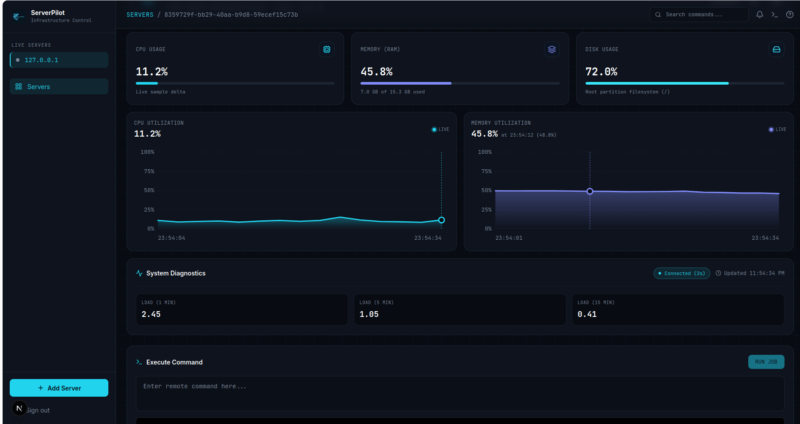
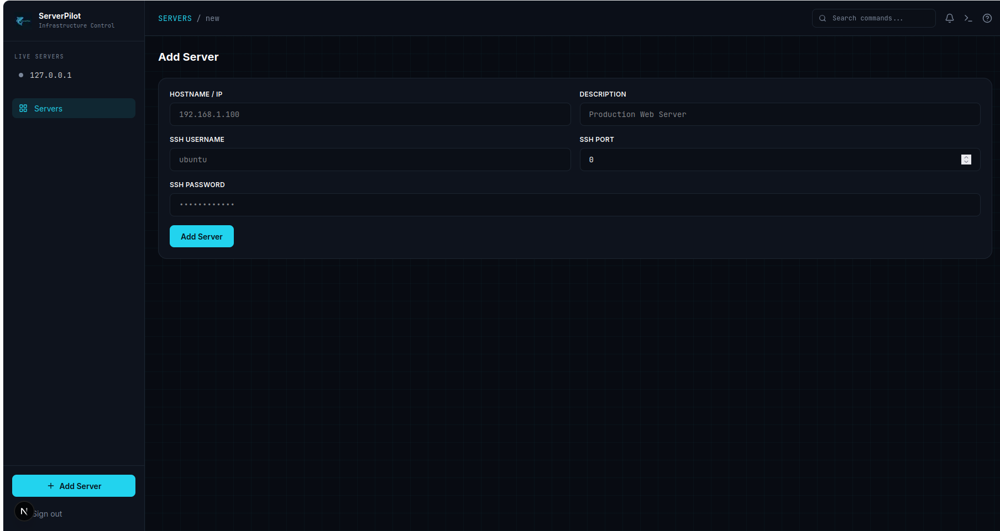
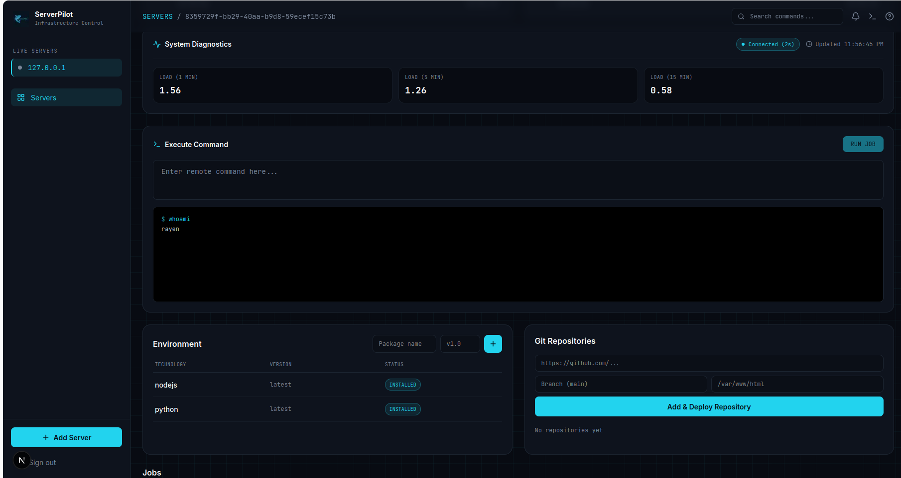

# ServerPilot 🚀

### Remote Linux Server Management & Monitoring Platform

ServerPilot is a full-stack web application designed to simplify remote Linux server administration. It provides a centralized interface for managing servers, executing commands remotely through SSH, and monitoring system resources.

The goal is to bring essential server management operations into one place, with a clean interface and real-time metric updates.

---

## 📸 Screenshots

### Dashboard

Get an overview of your registered servers and their connection status from a centralized dashboard.



### Server Connection

Register remote Linux servers by configuring their connection details and SSH authentication credentials.



### Remote Command Execution

Execute commands on remote Linux servers through SSH and retrieve their output directly from the application.



---

## ✨ Features

### 🖥️ Server Management

- Register and manage remote Linux servers.
- Configure SSH connection details.
- Securely store encrypted SSH credentials.
- Test server connectivity.
- View, update, and delete registered servers.

### ⚡ Remote Command Execution

- Execute commands on remote servers through SSH.
- Retrieve command execution output.
- Interact with remote infrastructure from a centralized interface.

### 📊 System Monitoring

- CPU usage monitoring.
- RAM utilization and memory statistics.
- Disk usage monitoring.
- System load averages (1, 5, and 15 minutes).
- Metric visualization through charts.
- Automatic metric updates using sequential HTTP polling.

### 🔐 Authentication & Security

- User registration and login.
- JWT-based authentication.
- Protected API endpoints.
- Encrypted SSH credentials.

---

## 🏗️ Architecture

ServerPilot follows a client-server architecture where the frontend communicates with a NestJS backend through REST APIs.

```text
                 ┌────────────────────────┐
                 │      Next.js Frontend  │
                 │                        │
                 │  Dashboard             │
                 │  Server Management     │
                 │  Monitoring Charts     │
                 │  Command Execution     │
                 └────────────┬───────────┘
                              │
                         REST API
                              │
                 ┌────────────▼───────────┐
                 │      NestJS Backend    │
                 │                        │
                 │  Authentication        │
                 │  Server Management     │
                 │  Monitoring            │
                 │  SSH Service           │
                 └───────┬────────┬───────┘
                         │        │
                    Prisma ORM    SSH
                         │        │
                 ┌───────▼────┐   ▼
                 │ PostgreSQL │  Linux Servers
                 │            │
                 └────────────┘
```

### Monitoring Workflow

1. The frontend sends an authenticated request to the monitoring API.
2. The backend establishes an SSH connection to the selected Linux server.
3. System resource information is collected from the remote machine.
4. The backend processes and returns the metrics as JSON.
5. The frontend updates the monitoring cards and charts.
6. Sequential polling retrieves new measurements approximately every two seconds, without starting overlapping requests.

---

## 🛠️ Tech Stack

| Technology   | Role                                         |
| ------------ | -------------------------------------------- |
| Next.js      | Frontend framework                           |
| React        | UI development                               |
| TypeScript   | Type safety                                  |
| Tailwind CSS | Styling                                      |
| NestJS       | Backend framework                            |
| PostgreSQL   | Relational database                          |
| Prisma       | Database ORM                                 |
| SSH2         | SSH connections and remote command execution |
| JWT          | Authentication                               |

---

## 📂 Project Structure

The application is split into two repositories:

- **Frontend** ([server-managment-front](https://github.com/kritrayen123-cpu/server-managment-front)): Next.js application responsible for the user interface, dashboard, monitoring visualizations, and API communication.
- **Backend** ([server-managment](https://github.com/kritrayen123-cpu/server-managment)): NestJS application responsible for authentication, database operations, server management, monitoring, and SSH communication.

---

## 🚀 Getting Started

### Prerequisites

Make sure you have installed:

- Node.js
- npm
- PostgreSQL
- Git
- SSH access to a Linux server

### 1. Clone the repositories

```bash
git clone https://github.com/kritrayen123-cpu/server-managment-front.git
git clone https://github.com/kritrayen123-cpu/server-managment.git
```

### 2. Backend Setup

Navigate to the backend directory:

```bash
cd server-managment
npm install
```

Configure the required environment variables using your backend `.env.example`.

Run database migrations or generate the Prisma client according to the backend setup instructions.

Start the development server:

```bash
npm run start:dev
```

### 3. Frontend Setup

Navigate to the frontend directory:

```bash
cd server-managment-front
npm install
```

Configure the backend API URL using the frontend environment configuration.

Start the development server:

```bash
npm run dev
```

Open your browser:

```text
http://localhost:3000
```

---

## 🔒 Security Notes

- SSH credentials are encrypted before database storage.
- JWT authentication protects restricted operations.
- Never expose environment variables, private keys, passwords, or authentication tokens.
- Use trusted SSH connections when managing production servers.

---

## 🗺️ Future Improvements

Potential areas of development:

- WebSocket-based metric streaming.
- Historical metrics storage and analysis.
- Configurable monitoring thresholds.
- Automated alerts and notifications.
- Advanced infrastructure monitoring.
- Multi-server monitoring improvements.

---

## 👨‍💻 Author

**Rayen Krit**

Software Engineering Student | Full-Stack Developer

- GitHub: [@kritrayen123-cpu](https://github.com/kritrayen123-cpu)

---

<p align="center">
  Built to make remote server management simpler.
</p>